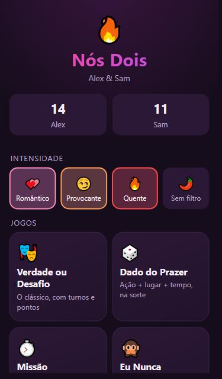
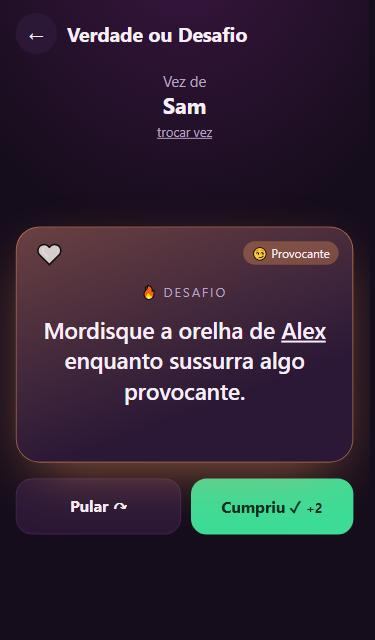
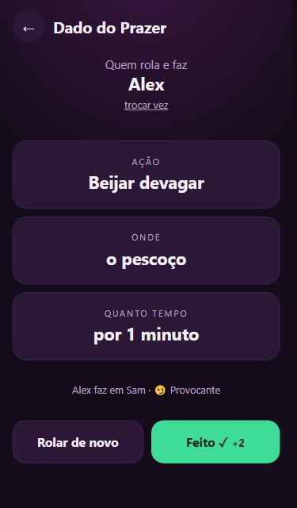
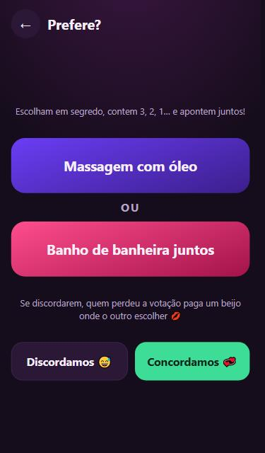

<div align="center">

# 🔥 Nós Dois

**Jogos para casais. Divertido, picante e 100% offline.**


&nbsp;
&nbsp;


</div>

---

## ✨ Sobre

**Nós Dois** é um app Android de jogos para casais. São nove jogos, mais de 300 cartas e quatro níveis de intensidade. O app vai do romântico ao sem filtro.

Tudo roda **localmente no celular**: não tem servidor, conta, login nem rastreamento. Os dados ficam só no aparelho.

> ⚠️ **Conteúdo adulto (+18).** Feito para casais adultos e consensuais. Qualquer carta pode ser pulada, sempre.

## 🎮 Jogos

| | Jogo | Como funciona |
|---|---|---|
| 🎭 | **Verdade ou Desafio** | O clássico, com turnos alternados e placar por nível de dificuldade |
| 🎲 | **Dado do Prazer** | Três dados sorteiam *ação + parte do corpo + tempo* |
| ⏱️ | **Missão Relâmpago** | Desafios contra o relógio, com cronômetro, vibração e alarme |
| 🙊 | **Eu Nunca** | Os dois votam "já fiz / nunca" e as respostas aparecem juntas |
| ⚖️ | **Prefere?** | Isso ou aquilo, com um medidor de *sintonia* do casal |
| 🎬 | **Fantasias** | 15 cenários de roleplay com papéis e frase de abertura |
| 💞 | **Conexão** | Perguntas profundas para se conhecerem melhor |
| 🎟️ | **Vales** | Sorteie vales, guarde na carteira de cada um e resgate depois, com animação |
| ✨ | **Surpresa** | Uma carta aleatória de qualquer jogo |

<div align="center">
&nbsp;

</div>

## 🌡️ Intensidade e limites

| Nível | Clima |
|---|---|
| 💕 **Romântico** | Carinho, memórias e declarações |
| 😏 **Provocante** | Beijos, toques e tensão no ar |
| 🔥 **Quente** | As roupas começam a sair |
| 🌶️ **Sem filtro** | Sem rodeios |

- **Combine níveis** livremente na tela inicial.
- **Escalada automática**: começa leve e sobe um nível a cada 6 cartas.
- **Limites**: desligue categorias inteiras (oral, brinquedos, vendas e amarras, pegada forte). As cartas desses temas deixam de aparecer.
- **Sem repetição**: uma carta só volta depois que todas as outras daquele jogo saírem.

## 🧩 Outros recursos

- ✍️ **Cartas personalizadas**: criem as suas, em qualquer jogo e nível
- ❤️ **Favoritos**: salvem as cartas que mais gostaram
- 🏆 **Placar** por jogador
- 🔒 **Bloqueio por PIN**: o app trava sempre que é minimizado
- 📳 Vibração, sons e animações
- ⬅️ Botão voltar do Android integrado

## 🛠️ Tecnologia

- **HTML, CSS e JavaScript puros**: sem framework e sem etapa de build
- **[Capacitor 7](https://capacitorjs.com/)** para empacotar como app Android nativo
- **localStorage** para guardar os dados no aparelho

```
nos-dois/
├── www/                 # o app
│   ├── index.html
│   ├── style.css
│   ├── app.js           # telas e lógica dos jogos
│   └── data.js          # todas as cartas
├── android/             # projeto Android (gerado pelo Capacitor)
├── docs/screens/        # capturas de tela
└── capacitor.config.json
```

## 🚀 Como rodar

### Pré-requisitos
- [Node.js](https://nodejs.org/) 18+
- [Android Studio](https://developer.android.com/studio) (fornece o Android SDK)
- **JDK 21**. O Java 25 que vem com versões recentes do Android Studio é novo demais para o Gradle 8.11.

> 💡 No Windows, mantenha o projeto num caminho **sem acentos** (ex.: `C:\dev\nos-dois`). O Gradle do Android não aceita caracteres não-ASCII no caminho.

### Instalação

```bash
git clone https://github.com/Andre-Brito-py/nos_dois.git
cd nos_dois
npm install
```

### Testar no navegador

Sirva a pasta `www/` com qualquer servidor estático:

```bash
npx serve www
```

### Gerar o APK

```bash
npm run apk
```

O script sincroniza o conteúdo de `www/` com o projeto Android, compila e copia o APK para `C:\dev\NosDois.apk`. Ele espera o JDK 21 em `C:\dev\jdk21`; ajuste o caminho no `package.json` se o seu estiver em outro lugar.

Para usar o Android Studio: rode `npm run open` e configure **Settings → Build Tools → Gradle → Gradle JDK** para o JDK 21.

### Instalar no celular

Passe o APK para o aparelho, permita **"instalar apps desconhecidos"** e toque em **Instalar**.

## ✍️ Adicionando cartas

Todo o conteúdo está em [`www/data.js`](www/data.js). O formato é simples:

```js
// [nível, texto, tag opcional]
// {a} = quem joga a vez · {b} = o par
[2, "Beije o pescoço de {b} bem devagar por 30 segundos."],
[4, "Use um brinquedo em {b} por 2 minutos.", "toy"],
```

Tags disponíveis: `oral`, `toy`, `bondage`, `rough`. Depois de editar, rode `npm run apk` de novo.

## 🔐 Privacidade

- Nenhum dado sai do aparelho: sem rede, analytics ou contas.
- Nomes, placar, vales, favoritos e cartas personalizadas ficam no armazenamento local do app.
- Desinstalar o app apaga tudo.

---

<div align="center">
Feito com 💜 para uso pessoal.
</div>
